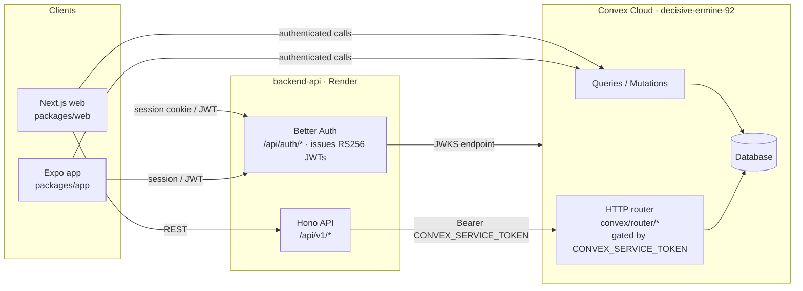

# GripKicks — Platform Blueprint

**Status:** Active  
**Last Updated:** 2026-09-16  
**Purpose:** Single source of truth for platform architecture and business model.

---

## 1. The Vision

A community-first climbing shoe platform that matches climbers to their perfect shoes based on foot shape, volume, and climbing style — then leverages that data to create a sellable B2B insights product for shoe brands.

**The hook:** "What worked for people with feet like yours."

---

## 2. The Business Model — B2B Data Flywheel

### The Flywheel

```
More free users → More stash data → Richer Reality Check metrics
      ↑                                          ↓
Better recommendations ← Brands pay for brand perception data
```

### How It Works

1. **Free consumer app** — All features free to climbers to maximize adoption
2. **Community data collection** — Users add shoes to Sanctuary, rate them, provide real-world fit feedback
3. **Gear Lab surfacing** — Community-powered recommendations build trust and engagement
4. **B2B monetization** — Brands pay for "Reality Dashboard" access

### What Brands Buy

- **Foot-profile-specific Reality Deltas** — "Your shoe is rated 1.2 points less aggressive than you claim, specifically by Egyptian-foot climbers."
- **Sizing Deviation Reports** — "On average, climbers downsize 0.5 sizes in your La Sportiva Katana vs. their Scarpa baseline."
- **Fit Longevity Signals** — "High-volume climbers report the shoe bagging out within 3 months."
- **Competitive Benchmarking** — How a brand stacks up against its category peers

### What Stays Free (Forever)

- All shoe recommendations and full radar matcher
- Reality Check comparisons (Brand Claim vs. Community Truth)
- Sole Mate Signals for your foot profile
- The Sanctuary (shoe stash)
- Foot scan and profile tools

### Data Ethics

- User data is **aggregated and anonymised** before being sold
- Users informed at signup that anonymous reviews contribute to community dataset
- Individual reviews are never attributable to a specific user in B2B reports

### Billing Infrastructure

No billing provider is currently integrated. Polar.sh was evaluated for B2B brand subscriptions (metered dashboard access, monthly/per-report pricing) and removed in Sept 2026 before any launch. Legacy `subscriptionStatus` / `subscriptionTier` / `polarCustomerId` fields remain on the users schema as the reserved B2B auth layer; revisit provider choice when B2B conversations begin.

---

## 3. Product — Sole Mate Gear Lab

### Status: Implemented

All core features shipped. Schema, scoring algorithm, and all UI components are live.

### Key Features

- **Match Score Breakdown (Tooltip/Hover):** Show weight of Foot Shape, Volume, and User Preferences instead of a single number
- **Reality Check Metrics:** Visual 1-5 scale comparing **Official Brand Claim** vs. **Community Truth**
- **Sole Mate Signals (Outliers):** Automated "High-Value" insights (e.g., "Heel Gap Risk," "Sizing Deviation") based on users with matching foot profiles
- **Optional Deep Dive:** Expandable sections for technical details (rubber compound, closure systems) — clean initial view, technically deep on demand

### Database Schema (Convex)

**Shoes table:**

- `brandAggressiveness` (1-5)
- `brandStiffness` (1-5)

**UserShoes table:**

- `perceivedAggressiveness` (1-5)
- `perceivedStiffness` (1-5)
- `perceivedVolumeFit` (e.g., "heel_gap", "tight_toe")
- `fitLongevity` (e.g., "1-3 months", "3-6 months", "6+ months")
- `sizingDeviation` (number, e.g., +0.5, -1.0)

**Outliers table:**

- `shoeId`, `footShape`, `volume`, `signalType`, `count`, `description`

### Scoring Algorithm

- **Sole Mate Weight:** Reviews from users with identical `footShape` and `footVolume` carry 3x weight
- **Reality Delta:** `OfficialMetric - AvgCommunityMetric`

### Scenarios

**Scenario: New user finds a first shoe**
1. A climber signs up and completes onboarding, which routes them into Foot Lab.
2. They set foot shape (e.g., Egyptian) and volume (e.g., low).
3. The Matcher ranks the catalog using the scoring algorithm; shoes with Sole Mate Signals for their profile surface context like "Heel Gap Risk."
4. They add a shoe to their Sanctuary and record size + perceived stats.

**Scenario: Community truth vs. brand claim**
1. A user opens a shoe's stats modal.
2. Reality Check shows the brand's claimed aggressiveness next to the community average; a delta >0.5 is highlighted.
3. The user expands Deep Dive for rubber compound and closure details.

**Scenario: Brand buys a report (future B2B)**
1. A brand authenticates against a `subscriptionStatus`-gated account.
2. The Reality Dashboard serves aggregated, anonymised deltas — e.g., sizing deviation reports segmented by foot profile.
3. No row-level or user-attributable data is ever returned (see Privacy).

---

## 4. Implementation Roadmap

The canonical roadmap and backlog are stored in Convex and managed from the **Backlog** tab at `/admin`. This document records platform architecture only; task status belongs in the admin backlog.

---

## 5. Deployment

### Current Stack

| Component   | Platform                    |
| ----------- | --------------------------- |
| Frontend    | Vercel (Next.js 16)         |
| Backend API | Render (Hono)               |
| Data Layer  | Convex Cloud                |
| Database    | Convex (decisive-ermine-92) |
| Mobile      | Expo / EAS (`packages/app`, not yet deployed) |

### Production Checklist

**Environment:**

- `NEXT_PUBLIC_CONVEX_URL` → `https://decisive-ermine-92.convex.cloud`
- `NEXT_PUBLIC_API_URL` → production backend URL
- `CONVEX_SERVICE_TOKEN` → the same high-entropy value in Render and Convex
- `BETTER_AUTH_URL` → production auth issuer in Convex
- Better Auth, Database, ImageKit variables set

**Deploy sequence:**

1. `npx convex deploy` — confirm schema changes and indexes
2. Deploy backend (Render)
3. Deploy frontend (Vercel)
4. Smoke test: Sanctuary, Profile, Add/remove shoes, Foot profile save
5. Verify health endpoint (`https://api.grip-kicks.com/health`)

**Monitoring:**

- Keep-alive ping every 5 minutes to prevent cold starts
- PostHog for analytics
- Cloudflare for web analytics

---

## 6. Tech Stack

- **Frontend:** Next.js 16, React 19, Tailwind CSS, Framer Motion
- **Mobile:** Expo / React Native (`packages/app`), Expo Router, @better-auth/expo
- **3D:** Three.js, React Three Fiber, React Spring
- **State:** Zustand (client), TanStack React Query (server)
- **Auth:** Better Auth + @convex-dev/better-auth
- **Data:** Convex (realtime, auth, database); Hono router modules under `convex/router/` mounted in `convex/http.ts`
- **API:** Hono + @hono/node-server
- **Validation:** Zod, neverthrow (Result-based error handling)
- **UI:** Radix UI primitives, Lucide icons, Lottie
- **Charts:** Chart.js + react-chartjs-2
- **Billing:** None integrated (Polar removed Sept 2026; B2B billing deferred)
- **Testing:** Vitest + Testing Library (unit), Playwright (e2e)

---

## 7. Design System

- **Theme:** Editorial × Precision Tool — climbing magazine meets engineering
- **Colors:** Dark, warm, focused — black backgrounds, orange-500 accents
- **Typography:** Tanker (display), Sora (body), So Cloudy (Sanctuary only)
- **Cards:** `bg-neutral-900 border-neutral-800 rounded-3xl`
- **Motion:** Page load fade-up, stagger children, hover lift

---

## 8. Architecture



### Why both Convex and a Hono service

**backend-api (Hono) is the single Better Auth issuer for every client, and the REST API surface for mobile.** Both web and the React Native app authenticate against it (`@better-auth/expo` + SecureStore on mobile), so there is one auth issuer, one session model, and one API contract across platforms. A long-running Node service also handles what Convex HTTP actions do awkwardly: image upload proxying and IP-based rate limiting.

**Convex** owns the data layer and serves user-scoped reads/writes directly to clients, JWT-verified via the Better Auth JWKS endpoint.

### Which path do I use?

| Need | Path |
|---|---|
| User-scoped read/write of app data (shoes, stash, profile) | Convex query/mutation from the client |
| Auth (sign-in, session, JWT issuance) | backend-api `/api/auth/*` |
| Image upload / ImageKit signing | backend-api |
| Anything needing IP rate limiting | backend-api |
| Service-to-service access to Better Auth tables | `convex/router/*` with `CONVEX_SERVICE_TOKEN` (never from a client) |

**Current state vs. intent:** mobile today uses backend-api for auth only and reads data directly from Convex (`convex/react`). The `/api/v1/*` REST surface exists for web and is the intended path for mobile data access as the app grows — that migration has not happened yet.

`router/authDb.ts` is not a second auth system: it is the persistence path the backend uses to read/write Better Auth tables inside Convex, behind the service token.

---

## 9. Security

### Trust boundaries

1. **Browser/app → Convex**: user JWTs verified via the Better Auth JWKS endpoint (`auth.config.ts`, RS256, `applicationID: "convex"`). Convex functions must never trust client-supplied user IDs — always resolve the caller from the verified token. Mobile obtains this token via `authClient.token()` and passes it to `ConvexReactClient`.
2. **Browser/app → backend-api**: Better Auth sessions — cookies on web, SecureStore-persisted tokens on mobile (`@better-auth/expo`). Crosses the public boundary, so auth endpoints are rate-limited (edge: Cloudflare; app: `RATE_LIMIT_*` env vars).
3. **backend-api → Convex router**: `CONVEX_SERVICE_TOKEN` Bearer auth with constant-time comparison (`convex/router/helpers.ts`). These endpoints assume a trusted caller — if the token leaks, the router exposes privileged user/auth operations. Token must be high-entropy, stored only in Render + Convex env vars, and rotated on suspicion.
4. **Convex router → public internet**: must never be reachable without the service token. No endpoint in `convex/router/` should be called from client code.

### Threats considered

- **Credential stuffing / brute force**: auth rate limits at Cloudflare edge + backend (`/api/auth/*` 10/min/IP suggested).
- **Token theft**: JWTs are RS256 signed by Better Auth; Convex only needs the public JWKS, so no shared signing secret exists client-side.
- **Service token leak**: see boundary 3 — single shared secret is the weakest link; a per-endpoint scope or Convex internal-only functions would reduce blast radius (open issue).
- **Injection**: Convex's parameterized queries + Zod validation at API boundaries.
- **Upload abuse**: image upload endpoints rate-limited (`RATE_LIMIT_UPLOAD_*`).

### Monitoring / alerting

- `/health` endpoint pinged every 5 min (prevents Render cold starts + liveness signal).
- PostHog for product analytics; Cloudflare for edge analytics.
- Gap: no automated alert on auth-failure spikes or 5xx rates — currently manual log review on Render/Convex dashboards.

---

## 10. Privacy

### Sensitive data handled

- **Account data**: email, name, OAuth identities, session tokens (Better Auth tables).
- **Foot profile + fit data**: foot shape, volume, perceived shoe stats, sizing deviations — the core of the B2B product.
- **Collection data**: which shoes a user owns.

### Safeguards

- B2B reports are **aggregated and anonymised** — individual reviews are never attributable to a specific user in brand-facing output.
- Users are informed at signup that anonymised reviews contribute to the community dataset.
- Account deletion removes the user's rows (see `AccountDeletion` component).

### Gaps to close before B2B launch

- Define a minimum aggregation threshold (e.g., no segment reported below N=10 users) to prevent re-identification in small cohorts.
- Define retention: how long deleted-user data persists in aggregates already computed.
- Legal review of the anonymisation claim before signing brand contracts — "anonymised" has a specific GDPR meaning.

---

## 11. Alternatives Considered

- **Polar.sh for B2B billing** — integrated then removed (Sept 2026) before launch; premature to operate billing infrastructure before any brand conversations exist. Revisit when B2B pipeline is real.
- **Single Convex-only backend (no Hono service)** — rejected: the Hono service is the single Better Auth issuer for web *and* React Native, and the REST API the mobile app will consume. Cross-platform auth was the deciding factor; image upload proxying and IP rate limiting also fit a long-running Node service better than Convex HTTP actions. Cost: two write paths contributors must choose between correctly — see the decision table in §8.
- **Postgres + ORM instead of Convex** — the original rationale is not recorded. Convex's realtime subscriptions and schema iteration speed are the apparent benefits, but this was not written down at decision time. Worth confirming, because it is the project's largest lock-in: reversing it means rewriting every query, the auth persistence layer, and the seed/enrichment scripts.
- **Stripe for B2C subscriptions** — rejected: all consumer features are free by design to maximize stash-data collection; charging climbers would shrink the dataset the B2B product depends on.

---

## 12. Open Questions

- How do we get more climbers to try the app? Current traction channels?
- What's the right moment to start B2B conversations? 1K users? 10K?
- Should the map feature be global or focus on specific regions first?
- What additional metrics would make the B2B product more compelling?
- Should `convex/router/*` service endpoints get per-route scoping instead of one shared `CONVEX_SERVICE_TOKEN`?
- Remove or repurpose the legacy `polarCustomerId` / `subscriptionStatus` schema fields?
